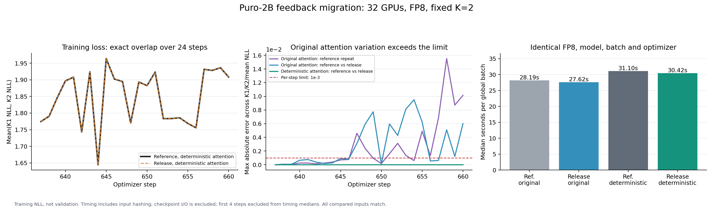

# Full-bandwidth feedback migration checks

Status: passed on 2026-11-17. Fresh and historical native FP8 trajectories,
checkpoint loading in both directions, and all-rank RNG restoration passed.

The implementation is based on `puro-2b` at
`a7b80e873a0b5e1820ae425b9abd1b9ec578dc5c`. The reference is the frozen
Dolma3 fixed-K2 mean-loss implementation identified in
[the source audit](ORIGIN_COMMITS.md). The tested runtime uses PyTorch
2.9.1+cu130, Transformer Engine 2.16.0+f45737c4, FlashAttention 2.8.3,
emerging-optimizers 0.2.0, and NumPy 1.26.4 on 32 RTX 5090 GPUs.

## Required numerical checks

Each optimizer step independently checks K1 NLL, K2 NLL, and their arithmetic
mean against an absolute error limit of `1e-3`. Input fingerprints must match
on all 32 ranks. Missing steps, changed batch/model/optimizer settings,
nonfinite losses, and a different loss objective fail the comparison.

The native tests retain FP8 E4M3 blockwise computation, BF16 parameters,
FP32 gradient accumulation, DP32/TP1/PP1/CP1, MBS 2, GBS 2,048, sequence
length 4,096, 17 recomputed layers per pass, and 2,048-token loss chunks.
The 13,892-step LR horizon is retained even for these short runs.

Strict trajectory checks use deterministic attention through
`NVTE_ALLOW_NONDETERMINISTIC_ALGO=0` in both repositories. This setting is
explicitly checked by `compare_puro_feedback_runs.py --full-config
--attention-deterministic`; it does not substitute BF16 decoder computation
or relax the loss bound.

| Check | Result |
| --- | --- |
| Feedback, checkpoint, HF loading, optimizer, comparison, existing Muon, and iterator RNG unit tests | 100 passed |
| Small BF16 model with AdamW, reference/release, 24 steps | All three loss errors 0 |
| Small BF16 model with AdamW, release 12+12 resume | All three loss errors 0 |
| Unchanged upstream baseline versus release K1, small BF16 AdamW control, 24 steps | Loss and gradient norm errors 0 |
| Native FP8 checkpoint 636 to 660, deterministic attention | All three loss errors and gradient norm difference 0 |
| Native FP8 final state comparison across all ranks | All 811 tensors bitwise equal |
| Release checkpoint model versus BF16-cast FP32 master weights | All 2,040,132,608 parameters equal |
| Native FP8 fresh HF initialization, 24 steps | All three loss errors and gradient norm difference 0 |
| Native FP8 release 12+12 resume, fresh and historical | All three loss errors and gradient norm difference 0 |
| Native FP8 source-to-release and release-to-source checkpoint loading, fresh and historical | All three loss errors and gradient norm difference 0 |
| Final DataLoader RNG isolation, 12 native FP8 steps | All three loss errors and gradient norm difference 0; all 811 state tensors bitwise equal |
| Final checkpoint RNG audit | Python, NumPy, Torch CPU/CUDA, and tracker states identical on all 32 ranks |

## Original attention settings

The original production setting allows nondeterministic attention. Even the
reference repository repeated from identical initial active state, packages,
and inputs exceeds `1e-3` after 24 steps:

| Original attention comparison | Max K1 error | Max K2 error | Max mean-loss error |
| --- | ---: | ---: | ---: |
| Reference versus itself | 0.0155143 | 0.0155191 | 0.0155169 |
| Reference versus release | 0.00950611 | 0.00930238 | 0.00940442 |

These are failed per-step numerical gates for that runtime configuration.
They are reported separately from the deterministic FP8 checks, which were
selected for migration acceptance. A short BF16 result alone would not
establish native FP8 parity.

## Checkpoint behavior and timing

The research fork omits its layer-wise optimizer from the condition that
finishes parameter synchronization before standalone checkpoint saves.
Normal production validation immediately before checkpointing synchronized
the model. Short tests that save without validation expose stale BF16 model
weights alongside updated FP32 master weights. The release includes the
layer-wise condition. The short reference checkpoint tests explicitly
synchronize before saving and record this workaround in their manifests;
their forward, backward, and optimizer computations are unchanged.

New release checkpoints also write the fixed legacy feedback semantic fields
required by the research fork. The live argument namespace is not modified.
No alternative feedback architecture or loss objective is enabled by those
compatibility fields.

The data loader uses a dedicated generator seeded with the training seed plus
DP rank. Recreating training or validation iterators therefore leaves the
model's CPU RNG unchanged. Unit tests check both sample order after resume and
RNG isolation; the final native follow-up additionally compares Python, NumPy,
Torch CPU/CUDA, and tracker states on all 32 ranks. All of these states match
exactly in the final native resume check.

For the historical 24-step deterministic FP8 comparison, median global-batch
time after the first four steps was 31.10 seconds in the reference and
30.42 seconds in the release. Peak allocated memory was approximately
28.73 GiB per GPU in both. Timing includes input fingerprint instrumentation
and excludes checkpoint I/O. These are short-run measurements, not a claim
of a general speedup. The research log counted one pass in its FLOPs counter;
the release counts both passes and feedback projections. Compare measured
batch time and input tokens, rather than the two logged TFLOP/s values.

The fresh 24-step comparison measured 31.05 seconds per global batch in the
reference and 30.40 seconds in the release, or approximately 270k and 276k
input tokens/s globally. All 8,388,608 input tokens per batch are counted
once, independently of the two decoder passes.

The 132-step fresh/resume/loading matrix uses release commit `4c3387f`; the
final dedicated-loader-generator change is commit `ad03b18`, checked by the
100-test suite and an additional 12-step native resume. These revisions keep
identical model, optimizer, batch, precision, and learning-rate settings.

The figure shows training NLL; it is not a validation-set learning curve.
